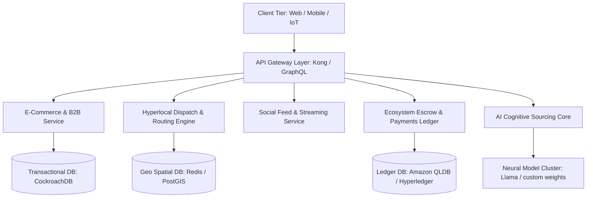

# OMNIX — Phase-by-Phase Technical Implementation Guide
## Step-by-Step Engineering Playbook for Building the Ultimate Commerce Operating System

---

## Executive Summary
This document outlines the end-to-end engineering, architectural, and deployment blueprint for **OMNIX**, the unified Commerce Operating System (OS). OMNIX absorbs consumer marketplace, B2B sourcing, hyperlocal quick commerce, social commerce, and creator economy modules into a single, cohesive ecosystem.

---

## System Architecture Blueprint

### 1. High-Level Architecture
OMNIX is designed as an event-driven, cloud-native microservices ecosystem to scale to **1 billion+ users** and **100 million+ sellers**.



---

## Step-by-Step Implementation Phases

### Phase 1: Foundational Core & Database Modeling (Months 1–3)
Establish the data integrity layer and identity access management.
*   **Step 1.1: Multi-Tenant Ledger Setup**: Configure a distributed SQL database (e.g., CockroachDB) supporting geographic partitioning to ensure low-latency transactions globally.
*   **Step 1.2: Cryptographic Escrow & Wallet Ledger**: Implement a double-entry ledger architecture for user/seller wallets using AWS QLDB or Hyperledger to maintain non-repudiation.
*   **Step 1.3: Identity & Role Engine**: Deploy a unified authentication service (OAuth2/OIDC) with zero-trust credentials and adaptive multi-factor checks.

### Phase 2: AI Cognitive Core & Sourcing Engine (Months 4–6)
Build the predictive intelligence layer.
*   **Step 2.1: Semantic Vector Database**: Index product listings, B2B catalogs, and creator storefront assets into a vector store (e.g., Pinecone or Milvus) using text-embeddings.
*   **Step 2.2: Autonomous Negotiation Agent**: Train an LLM agent with specific reinforcement learning parameters to evaluate seller margins and negotiate bulk/wholesale pricing automatically.
*   **Step 2.3: Smart Pantry Analytics**: Establish time-series analytics (InfluxDB) tracking household consumption patterns to predict run-out dates and trigger automated replenishment orders.

### Phase 3: Hyperlocal Dispatch & Routing Engine (Months 7–9)
Optimize delivery speed.
*   **Step 3.1: Geospatial Indexing**: Map Dark Stores using H3 spatial index grids. Set up real-time rider tracking via WebSocket connections feeding into redis geospatial databases.
*   **Step 3.2: Dynamic Routing Algorithm**: Build a graph-based vehicle routing solver (using OSRM or customized Dijkstra algorithms) updating dispatch coordinates dynamically every 2 seconds.
*   **Step 3.3: Dark Store Automated Inventory**: Connect RFID and weight-sensor nodes within dark stores to automatically alert packaging queues.

### Phase 4: Social & Creator Storefronts (Months 10–12)
Power the creator economy.
*   **Step 4.1: Shoppable Media Delivery**: Configure CDN caching (Cloudflare) and video optimization (HLS streams) for shoppable reels.
*   **Step 4.2: Digital storefront assets**: Build the digital file storage and CDN streaming paths for creators uploading templates, presells, and consultations.
*   **Step 4.3: Affiliate Tracking ledger**: Maintain an immutable ledger mapping video item clicks to successful payments, distributing commissions automatically.

### Phase 5: Security Shield & Scaling (Months 13–15)
Guard against external attacks.
*   **Step 5.1: Zero-Trust Network Access**: Configure strict mutual TLS (mTLS) between all microservices.
*   **Step 5.2: AI Fraud Guard**: Establish real-time behavioral checks analyzing IP drift, transaction velocity, and cart outliers.
*   **Step 5.3: Global Load Balancer**: Set up Multi-Region active-active deployments across AWS/GCP with dynamic routing based on geographical proximity.

---

## DevOps & Deployment Playbook

### Infrastructure Stack
- **Containerization**: Docker & Kubernetes (EKS/GKE)
- **CI/CD Pipeline**: GitHub Actions deploying to staging, then auto-promoting to production upon passing integration tests.
- **Monitoring**: Prometheus scraping metrics from services, visualized in Grafana dashboards, with Alertmanager triggering PagerDuty alerts.

```yaml
# Sample Kubernetes Deployment for OMNIX Core AI Service
apiVersion: apps/v1
kind: Deployment
metadata:
  name: omnix-ai-sourcing
  namespace: omnix-core
spec:
  replicas: 5
  selector:
    matchLabels:
      app: omnix-ai-sourcing
  template:
    metadata:
      labels:
        app: omnix-ai-sourcing
    spec:
      containers:
      - name: sourcing-engine
        image: gcr.io/omnix-production/ai-sourcing:v2.4
        ports:
        - containerPort: 8080
        resources:
          limits:
            cpu: "4"
            memory: 8Gi
          requests:
            cpu: "2"
            memory: 4Gi
```
