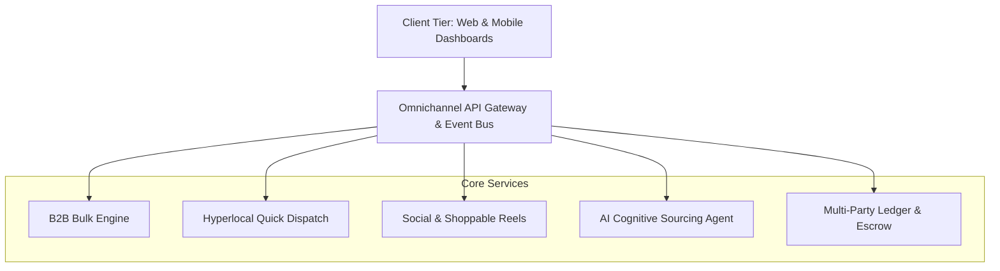

# 🌐 OMNIX: The Next-Generation Unified Commerce Operating System

[](https://opensource.org/licenses/MIT)
[](#)
[](#)
[](#)
[](#)

> **OMNIX** is an all-in-one digital commerce platform unifying **Consumer Marketplace**, **B2B Bulk Sourcing**, **Hyperlocal Quick-Commerce (10-min delivery)**, **Social Shoppable Media**, **Creator Storefronts**, and an **Autonomous AI Sourcing Agent** into a seamless, interconnected operating system.

---

## 🏛️ Ecosystem Overview & Sub-Portals

OMNIX provides 8 fully integrated modules out-of-the-box:

| Module | File | Key Capabilities |
| :--- | :--- | :--- |
| **🛍️ Consumer Marketplace** | [`index.html`](./index.html) | Universal catalog browsing, omnichannel search, intelligent recommendations, and unified checkout. |
| **🏢 B2B Enterprise Sourcing** | [`b2b.html`](./b2b.html) | Wholesale tier pricing, bulk minimum order quantities (MOQ), tax invoicing, and credit terms. |
| **⚡ Quick Commerce (Hyperlocal)** | [`quick-commerce.html`](./quick-commerce.html) | 10-minute dark store fulfillment, geospatial live rider tracking, and dynamic stock allocation. |
| **🎬 Social Commerce** | [`social-commerce.html`](./social-commerce.html) | Shoppable short-form video feeds, interactive product tags, and real-time community engagement. |
| **🎨 Creator Hub** | [`creator-hub.html`](./creator-hub.html) | Influencer storefronts, affiliate link tracking, digital asset distribution, and automated commission payouts. |
| **📊 Merchant Seller Studio** | [`seller-studio.html`](./seller-studio.html) | Inventory management, multi-channel pricing rules, fulfillment dispatch, and financial ledgers. |
| **📈 Executive Dashboard** | [`dashboard.html`](./dashboard.html) | Real-time GMV metrics, active user heatmaps, cart drop-off analysis, and operations telemetry. |
| **🤖 AI Cognitive Agent** | [`ai-agent.html`](./ai-agent.html) | Autonomous price negotiation agent, pantry re-order prediction, and conversational purchase assistance. |

---

## 📐 System Architecture Blueprint



---

## 📖 Complete Documentation & Blueprints

Detailed operational and technical manuals are bundled directly in this repository:

- 📘 [**OMNIX Technical Implementation Guide**](./OMNIX-Implementation-Guide.md): 5-phase engineering playbook detailing microservices architecture, vector database indexing, Kubernetes deployments, and security models.
- 📗 [**OMNIX User Manual**](./OMNIX-User-Manual.md): Comprehensive end-user documentation explaining navigation, order management, and seller workflows.

---

## 🚀 Getting Started & Previewing Locally

Because OMNIX is built with modular modern web technologies, you can run the entire suite locally without complex prerequisites:

### Quick Run via VS Code Live Server or Python HTTP:

```bash
# Clone the repository
git clone https://github.com/avrojitsaha763-byte/OMNIX.git
cd OMNIX

# Start a local web server
python -m http.server 8080
```

Open your browser to:
- **Consumer Portal:** `http://localhost:8080/index.html`
- **B2B Portal:** `http://localhost:8080/b2b.html`
- **Quick Commerce:** `http://localhost:8080/quick-commerce.html`
- **Creator Hub:** `http://localhost:8080/creator-hub.html`
- **Analytics Dashboard:** `http://localhost:8080/dashboard.html`

---

## 📂 Project Organization

```text
├── index.html                  # Consumer Marketplace Landing
├── b2b.html                    # B2B Sourcing Portal
├── quick-commerce.html         # Hyperlocal Quick Commerce
├── social-commerce.html        # Shoppable Video Feed
├── creator-hub.html            # Creator Storefronts & Affiliates
├── seller-studio.html          # Merchant Management Studio
├── dashboard.html              # Executive Analytics Dashboard
├── ai-agent.html               # Autonomous AI Sourcing Agent
├── OMNIX-Implementation-Guide.md # Technical Architecture Blueprint
├── OMNIX-User-Manual.md        # User Guide & Operations Manual
├── assets/                     # Media & graphic assets
├── css/                        # Design stylesheets & UI themes
└── js/                         # Client-side routing & interaction scripts
```

---

## 📄 License

Distributed under the MIT License. Designed & Developed by **[Avrojit Saha](https://github.com/avrojitsaha763-byte)**.
